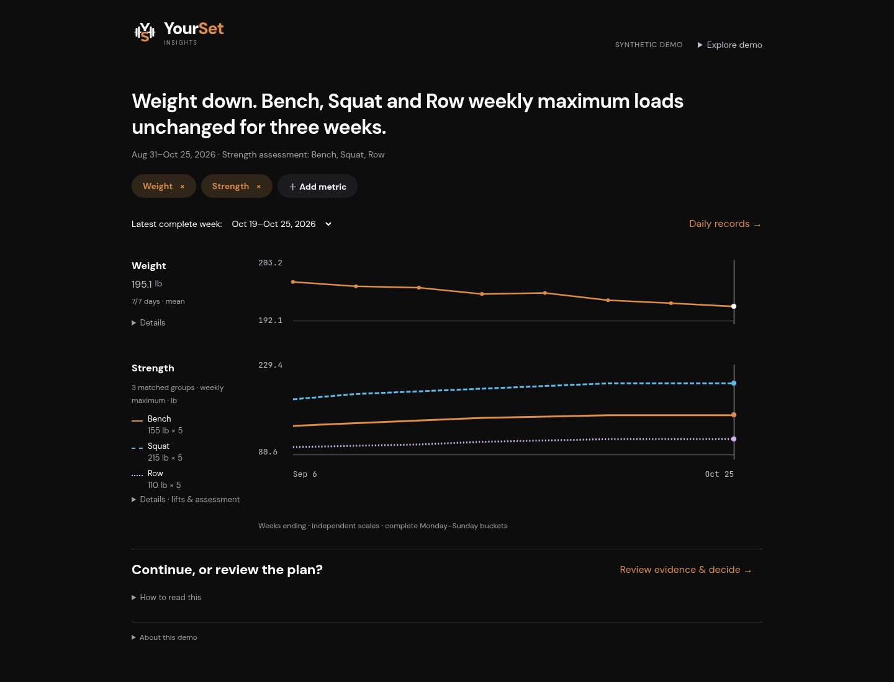
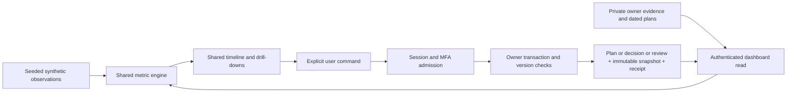

# YourSet Insights

Weight, food logs and training can tell different stories. YourSet Insights brings them into one review so you can decide what to investigate, record an action and later compare the outcome with the evidence you had at the time.

The central lesson: useful guidance depends on showing what the data can support. Missing records, changed exercises and uncertain explanations stay visible.

**[Open the interactive demo](https://yourset-insights-demo.vercel.app/)** · [Follow the walkthrough](#a-short-walkthrough) · [How this was built](#how-this-was-built)

[](https://github.com/pkkeable/yourset-insights-demo/actions/workflows/privacy.yml)

No account, health export or model API is required. The demo uses independently generated synthetic records and resets on reload.

[](https://yourset-insights-demo.vercel.app/)

## A short walkthrough

1. **Read the shared timeline.** Weight and Strength start selected. Add any supported metric, inspect one week across the tracks, then open Daily records for the observations behind it. Strength overlays Bench, Squat and Row; the Strength tab can split them into separate charts.
2. **Challenge the explanation.** Open Investigations. Compare supporting observations, conflicting evidence and gaps. More logged calories and fewer steps can accompany slower weight loss; the app does not assign causal percentages or prescribe a calorie cut.
3. **Choose what to do.** Accept a bounded action, write an adjustment, defer, reject or continue unchanged. Only an explicit target edit changes the dated plan.
4. **Return and review.** Load the independent synthetic follow-up, then finish a review. History retains the original assessment, plan and evidence snapshot alongside the later outcome. It never rewrites the earlier conclusion to fit what happened next.

Open Explore demo to switch scenarios or visit Strength, Training and Nutrition / Weight. Metric Details explains calculations and coverage. Selected metrics without eligible observations remain visible as compact rows; gaps within a series stay missing. Review evidence & decide opens Investigations and the decision loop.

See the same synthetic fixture with [five selected metrics](docs/images/expanded.png), on [mobile](docs/images/mobile.png), and with [strength split by lift](docs/images/strength-split.png).

## How this was built

[Preston Keable](https://github.com/pkkeable) defined the product problem, reporting priorities, privacy boundaries and acceptance criteria, and reviewed the resulting experience. AI coding agents implemented much of the application and automated verification. The engineering notes connect implementation findings to the decisions and verification that followed.

Three decisions show that direction in the product:

- **Make the overview useful at a glance.** Review of an overly dense screen led to a brief assessment and a shared timeline, with Weight and Strength selected by default and evidence available through Details and Daily records. See the [design contract](docs/DESIGN.md).
- **Explain progress without pretending to know its cause.** The product brief prioritised body composition, recovery and the relationship between intake and activity. The implementation does not infer tissue change from scale weight, treats attendance separately from matched lift performance, and keeps missing observations distinct from zero. See the [metric contract](docs/METRICS.md).
- **Make the portfolio public while keeping personal use private.** One implementation supplies an independent synthetic demo and a separate private-runtime foundation. Public exports must pass source and privacy review before publication; private development history stays private. See the [publication boundary](docs/PUBLICATION.md).

[AGENTS.md](AGENTS.md) defines the rules agents worked under. [Engineering findings](ENGINEERING.md) records constraints caught during implementation and verification, including a runner that checks actual port bindings instead of trusting requested settings. [Capabilities](docs/CAPABILITIES.md) distinguishes those observations from what remains unproven.

## What is in this repository

| Area | Purpose and status |
| --- | --- |
| `src/`, `web/` and the static build | The working synthetic product: shared calculations, selectable timeline tracks, investigations and a decision/review loop. This supplies the static public demo. |
| `private-api/` and `dev/local/` | The private-runtime foundation and disposable verification harness. Local tests cover authenticated reads, durable commands, MFA and owner isolation. A supported personal installation remains separate work. |
| `adapters/`, `collectors/` and `spikes/` | Offline import groundwork, an optional Garmin candidate and an isolated architecture experiment. These are not live integrations and are excluded from the hosted build. |

The private-runtime foundation includes authentication and database boundaries tested locally; a supported personal installation remains separate work. They are not needed to run the public demo. The [source capability table](docs/SOURCES.md) identifies what each connector actually supports.

## Why the calculations are conservative

A sync is not a complete food log. Weight is not a measurement of fat or lean tissue. A different machine is not a comparable lift. Missing recovery observations are not zeros.

One deterministic engine applies completed-day windows, dated targets, the app that originally recorded each observation, source revisions and exact exercise comparisons. The charts and narrative use those same results. There is no global readiness score, automatic numerical prescription, wearable-calorie adjustment or photo body-fat estimate.

## Architecture



The framework-free browser UI and static build keep the public demonstration easy to inspect. The private Node runtime uses PostgreSQL row-level security, server-mediated Supabase Auth/TOTP, opaque HttpOnly cookies and encrypted server-side tokens. An idempotency receipt commits with each command: a lost response can be retried without creating a second action. Private read failures show an unavailable state; they never substitute demo data.

| Read more | What it explains |
| --- | --- |
| [Metric contract](docs/METRICS.md) and [source model](docs/DATA_CONTRACT.md) | Windows, completeness, lineage, units, coverage and comparable lifts |
| [Command contracts](docs/COMMAND_CONTRACTS.md) | Atomic saves, immutable evidence, conflicts, retries and bounded reads |
| [Architecture decision](docs/adr/0001-write-and-session-boundary.md) | Why ownership and session admission are enforced separately |
| [Engineering findings](ENGINEERING.md) | Bugs and constraints that shaped the boundary |
| [Design](docs/DESIGN.md) | The shared timeline, retained private overview and accessible drill-downs |
| [Capability matrix](docs/CAPABILITIES.md) | Dated evidence and what remains unproven |

## Run it locally

Install **Node.js 22 or later**, then run:

```sh
npm ci
npm run dev
```

Open **http://127.0.0.1:4173/**. The initial scenario is “Returning lifter”, covering August 31–October 25, 2026, with a fixed reference date of October 26, 2026. `npm run build` produces the allowlisted static site in `dist/`; relative asset paths support an origin root or a project subdirectory.

Synthetic decisions last only for the current tab and reset on reload. The private runtime persists them to a local database; its disposable verification setup is **not a personal installation**.

## Verify it

```sh
npm run check
npm run build
```

`check` runs syntax, formatting, tracked-tree privacy checks and JavaScript tests. CI adds the hash-pinned Python collector/reference tests, lint and a Chromium walkthrough of the built static demo under its hosted subdirectory. Local integration tests exercise actual PostgreSQL, Auth, HTTP routes and Chromium, including owner isolation, MFA, rollback, retries, restart and mobile rendering:

```sh
npm run test:product-slice
npm run test:auth
```

Those two suites require the supported **macOS ARM + Docker Desktop** environment and download pinned service/browser images on first use. Follow [the local verification guide](dev/local/README.md); the runner refuses existing test resources and checks actual loopback bindings before use. See [supported platform](docs/SUPPORTED_PLATFORM.md) for exact versions and limitations.

## Current boundaries

The synthetic product and authenticated local decision loop are tested. Personal-source ingestion, a persistent Mac launcher, account recovery, backups and unattended refresh remain separate work. Hosting the synthetic demo does not establish private hosted operation, provider account validation, physiological benefit or an elapsed unattended trial. Hevy and Apple Health adapters are offline groundwork; Garmin is an optional candidate, and Strava is excluded. See [source capabilities](docs/SOURCES.md) and the [private runbook](docs/RUNBOOK.md).

Private configuration, records and operational reports belong outside source control. The initial public release used a fresh reviewed source snapshot. Later releases keep normal public history while importing only reviewed source files; private development history stays private. [Privacy workflow](docs/PRIVACY_WORKFLOW.md) · [Publication boundary](docs/PUBLICATION.md).

## Attribution and rights

The source remains **UNLICENSED**, with no reuse rights granted. Public visibility is for review. The bundled DM Sans and JetBrains Mono assets retain their SIL Open Font License notices in `web/assets/`. The YourSet mark is owner-provided.

This software demonstration does not diagnose, treat or prescribe. Its comparisons have not been clinically validated.
